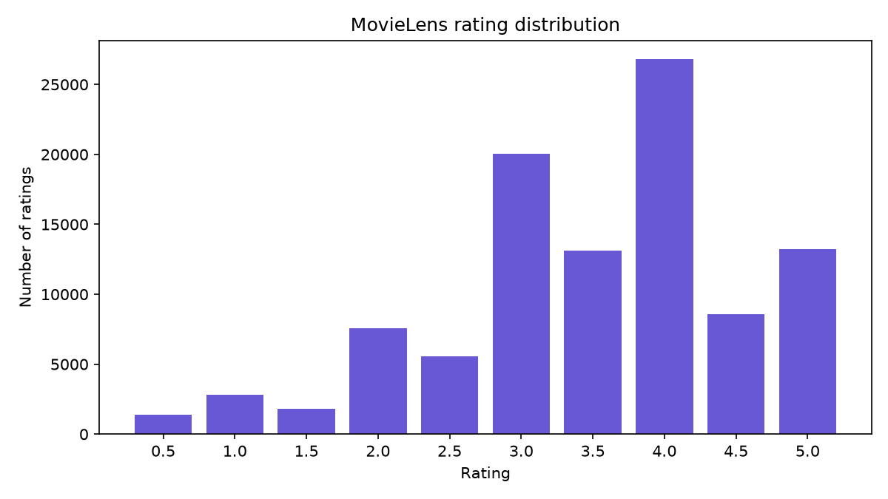
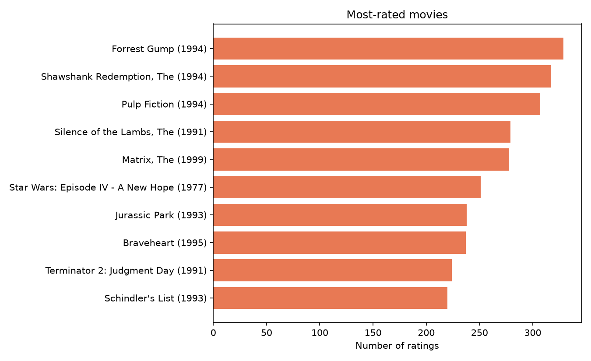
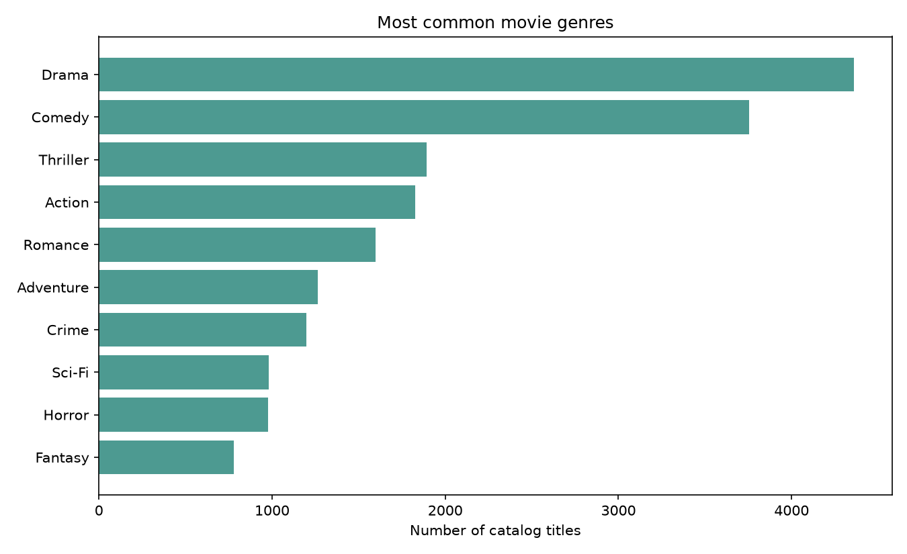
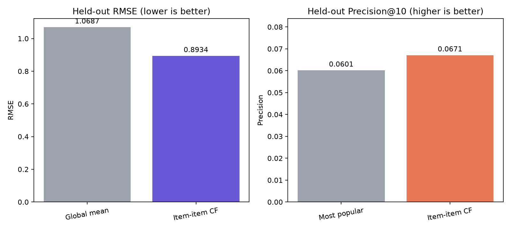
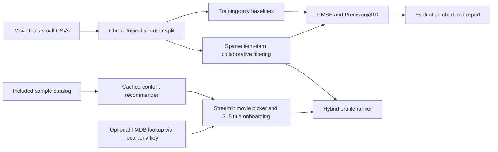

# Movie Recommendation System

A small, reproducible movie discovery project with a Streamlit app, a content-based recommender, and an offline collaborative-filtering evaluation on MovieLens small.



## What it does

- Suggests similar movies using TF-IDF features from genres and, when available, overview text.
- Personalizes results from 3–5 movie ratings with a weighted content/community hybrid when MovieLens small is available; it falls back to content-only rankings when it is not.
- Runs a fast, local Streamlit demo using the included 15-title sample catalog. No API key or dataset download is needed for the app.
- Evaluates sparse item-item collaborative filtering on a per-user chronological holdout and compares it with simple baselines.
- Includes an EDA notebook, generated charts, reusable Python modules, and tests.

## Screenshots and results

The graphs below are generated by the project's EDA and evaluation commands.

| Rating distribution | Most rated titles |
|---|---|
|  |  |



### Held-out MovieLens evaluation

| Metric | Baseline | Item-item model |
|---|---:|---:|
| RMSE (lower is better) | 1.068659 global mean | 0.893428 |
| Precision@10 (higher is better) | 0.060135 popularity | 0.067061 |

Results use a per-user latest-timestamp holdout: 80,116 training ratings and 20,720 test ratings. Precision@10 is macro-averaged over 592 users with at least one held-out rating of 4.0 or higher. Metrics are offline results on this dataset, not a measure of real-world user satisfaction. See [`docs/06_TESTING_EVALUATION.md`](docs/06_TESTING_EVALUATION.md) for details.



## Architecture



The app uses the included catalog so its first page starts quickly and works offline. If MovieLens small is present, new-user ratings can also use community item-item scores where sample titles match MovieLens IDs. The same dataset is used by EDA and offline collaborative evaluation. Raw data is downloaded locally and excluded from Git.

## Quick start

### Windows PowerShell

```powershell
py -m venv .venv
.\.venv\Scripts\Activate.ps1
python -m pip install -r requirements.txt
streamlit run src/app.py
```

### macOS / Linux

```bash
python3 -m venv .venv
source .venv/bin/activate
python -m pip install -r requirements.txt
streamlit run src/app.py
```

The app opens in your browser. Choose a single favorite or select and rate 3–5 titles to build a profile, then set the number of suggestions. Similarity scores are relative rankings, not probabilities. Content features are cached across reruns. The collaborative profile model is loaded only when needed; download MovieLens small to enable community ratings.

### Optional TMDB posters

Posters and overviews are optional. Copy `.env.example` to `.env`, add your own TMDB API key, and restart Streamlit. Without a key, the app makes no TMDB requests.

```powershell
Copy-Item .env.example .env
```

```bash
cp .env.example .env
```

## Reproduce the data exploration and evaluation

After installing dependencies and activating the environment, download the allowed MovieLens small dataset from GroupLens and regenerate the analyses:

```bash
python src/download_data.py
python -m src.eda
python -m src.collab
python src/recommender.py
python -m pytest -q
```

`python src/download_data.py` saves the dataset under `data/ml-latest-small/`. The downloader verifies the HTTPS source and safely extracts files. The dataset and other generated raw files are ignored by Git. The source, license information, schema, and quality checks are recorded in [`docs/04_DATA.md`](docs/04_DATA.md).

To explore the notebook, start Jupyter and open `notebooks/01_eda.ipynb`.

## Project layout

```text
docs/       project brief, requirements, architecture, data, roadmap, testing, risks, deliverables, report
src/        data loading, downloader, EDA, recommenders, Streamlit app
tests/      automated tests for data, ranking, and evaluation
notebooks/  EDA walkthrough
reports/    generated charts
```

## Method

### Content-based recommendations

`src/recommender.py` vectorizes movie genres and optional overview text with TF-IDF, then ranks candidates by cosine similarity. The selected movie is excluded from its own results. If overview text is missing, genre features are used. The included sample catalog makes this method easy to try without a download.

`src/hybrid.py` builds a new-user profile from three to five sample-catalog ratings. It blends content relevance with community predictions from `src/collab.py` when the profile and candidate titles map to MovieLens IDs; unmatched titles use content rankings. The MovieLens model is loaded only when profile recommendations are requested. `src/tmdb.py` optionally fetches cached posters and overviews when `TMDB_API_KEY` is present in `.env`.

### Collaborative filtering and evaluation

`src/collab.py` splits each user's ratings chronologically, holding out the latest timestamp block at or after the user's 80th percentile. Equal timestamps remain together; users without two distinct timestamps stay in training. The model learns sparse item-item similarities from training ratings only. Global-mean RMSE and training-only popularity Precision@10 provide simple reference baselines.

## Tests

Run from the repository root:

```bash
python -m pytest -q
```

The tests cover catalog validation, title lookup, recommendation ranking, temporal splitting, leakage safeguards, and offline metrics. The Streamlit page was also opened and manually checked in a browser.

## Data and privacy

- MovieLens small is provided by [GroupLens](https://grouplens.org/datasets/movielens/); it is downloaded with the repository script and is not committed.
- The core app needs no credentials and keeps ratings local to the current app session.
- Optional TMDB metadata sends displayed title names to TMDB only if you configure a key.
- See [`docs/07_RISKS_ETHICS.md`](docs/07_RISKS_ETHICS.md) for limitations and responsible-use notes.

## Project documentation

Start with [`docs/01_PROJECT_BRIEF.md`](docs/01_PROJECT_BRIEF.md), then see the requirements, architecture, data notes, roadmap, evaluation results, and final report under `docs/`.
